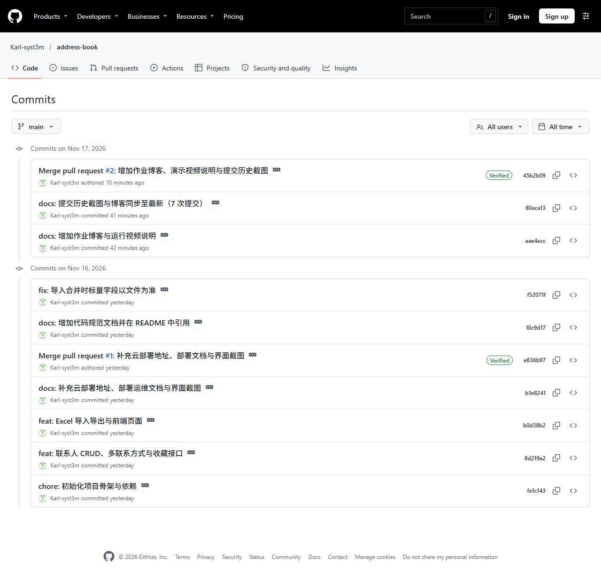

# 极限编程作业：通讯录 Web 应用（收藏 / 多联系方式 / Excel 导入导出）

> 作业来源：<https://bbs.csdn.net/topics/620593436>（极限编程 Extreme Programming，Deadline：2026-11-17 23:59）

| 项目 | 内容 |
| --- | --- |
| 本次作业所属课程 | Software Engineering (FZU–MU) |
| 团队名称 | 单人项目（房嘉炜 832401110） |
| 作业要求 | Fork/建立 GitHub 仓库（commit ≥ 3）、实现收藏联系人 / 多联系方式 / Excel 导入导出、发布一个版本并发起 PR、撰写博客、可选云部署 |
| 本作业目标 | 每位同学参与编码、体验完整开发流程（需求拆解 → 设计 → 编码 → 测试 → 部署 → 文档） |
| 其他参考资料 | Node.js 官方文档（`node:sqlite`）、Express 4 文档、ExcelJS 文档、本仓库 [docs/CODE_STYLE.md](https://github.com/Karl-syst3m/address-book/blob/main/docs/CODE_STYLE.md) |

## 目录

- [一、作业说明](#一作业说明)
- [二、项目地址](#二项目地址)
- [三、提交历史与贡献统计](#三提交历史与贡献统计)
- [四、功能实现思路](#四功能实现思路)
- [五、程序截图与运行视频](#五程序截图与运行视频)
- [六、分工与贡献比](#六分工与贡献比)
- [七、遇到的困难与解决方式](#七遇到的困难与解决方式)
- [八、PSP 表](#八psp-表)
- [九、对照评分标准自查](#九对照评分标准自查)

---

## 一、作业说明

本次作业以「通讯录」为载体，要求实现三类基础功能，并可选择性完成云部署：

| 功能 | 分值 | 具体要求 |
| --- | --- | --- |
| 收藏联系人 | 25 | 可收藏/取消收藏重要或常联系人，并能方便访问 |
| 增加多种联系方式 | 10 | 一个联系人可关联电话、邮箱、社交账号、地址等多种方式 |
| 导入与导出 | 25 | 导出为 Excel（一人一行、一类信息一列）；导入格式正确的 Excel 加入通讯录 |
| Web 云部署（可选） | +15 | 部署到云服务器，`localhost` 不算 |

基础要求 30 分（Markdown 博客排版 + 仓库/代码规范链接正确 10 分；实现思路、截图、分工 20 分），编码实现 70 分。

## 二、项目地址

| 类型 | 地址 |
| --- | --- |
| GitHub 仓库 | <https://github.com/Karl-syst3m/address-book> |
| 在线访问（云部署） | <http://103.236.57.2:3000> |
| 发布版本 | <https://github.com/Karl-syst3m/address-book/releases/tag/v1.0.0> |
| Pull Request | <https://github.com/Karl-syst3m/address-book/pull/1> |
| 代码规范 | <https://github.com/Karl-syst3m/address-book/blob/main/docs/CODE_STYLE.md> |
| 部署文档 | <https://github.com/Karl-syst3m/address-book/blob/main/docs/DEPLOY.md> |

技术栈：**Node.js 24 + Express 4 + Node 内置 `node:sqlite` + ExcelJS**，前端为原生 HTML/CSS/JS（无框架、无构建步骤）。

选型理由：整个项目只有 3 个运行时依赖，其中数据库直接使用 Node 24 内置的 `node:sqlite`，**不需要 better-sqlite3 这类需要本地编译的原生模块**，换任何一台机器 `npm ci` 都能装好，也方便部署到云服务器。

## 三、提交历史与贡献统计



| 贡献者 | GitHub 账号 | 提交次数 |
| --- | --- | --- |
| 房嘉炜（832401110） | Karl-syst3m | 7 |

提交按「工程骨架 → 业务接口 → 前端与导入导出 → 文档与部署」拆分，每个提交只做一件事，正文说明为什么这么做，便于回溯：

```
f52071f fix: 导入合并时标量字段以文件为准
10c9d17 docs: 增加代码规范文档并在 README 中引用
e836b97 Merge pull request #1: 补充云部署地址、部署文档与界面截图
b1e8241 docs: 补充云部署地址、部署运维文档与界面截图
b0d38b2 feat: Excel 导入导出与前端页面
8d219a2 feat: 联系人 CRUD、多联系方式与收藏接口
fe1c143 chore: 初始化项目骨架与依赖
```

## 四、功能实现思路

### 4.1 数据模型：一个联系人 → 多条联系方式

「多联系方式」的核心是一对多。没有把电话/邮箱做成 `contacts` 表上的固定列，而是拆出独立表：

```sql
contacts(id, name, company, note, bookmarked, created_at, updated_at)
contact_methods(id, contact_id → contacts.id, type, value, label, is_primary)
```

- `type` 限定 6 种：`phone / email / wechat / qq / address / other`，非法值返回 400；
- 每条联系方式带 `label`（如「工作邮箱」）和 `is_primary`（首选标记）；
- 外键 `ON DELETE CASCADE` + `PRAGMA foreign_keys = ON`，删人不会留下孤儿数据。

好处是数量不受限、扩展新类型不用改表结构；代价是列表查询要聚合，因此按 `contact_id` 建了索引。

### 4.2 收藏联系人

`bookmarked` 是 `contacts` 上的整型标记，单独提供 `PATCH /api/contacts/:id/bookmark` 而不是走全量 `PUT`，避免为了点个星标要回传整个联系人及其联系方式。

- 列表支持 `?bookmarked=1` 只看收藏；
- 前端点击星标后本地乐观更新 + 重新拉统计，顶栏「收藏数」即时变化；
- 校验 `bookmarked` 必须是布尔，缺字段返回 400。

### 4.3 Excel 导出：一人一行、一信息一列

列固定为 14 列，与作业要求对齐：

```
姓名 | 公司 | 收藏 | 电话1 | 电话2 | 电话3 | 邮箱1 | 邮箱2 | 邮箱3 | 微信 | QQ | 地址 | 其他 | 备注
```

- 同一类型的多条记录按顺序填入 `1..3` 列；**超出 3 条的不会被丢掉**，会以 `类型:值` 的形式合并进「其他」列（如 `电话:025-88889999`），保证信息不丢失；
- 收藏列写「是」/ 空，导入时兼容 `是 / 1 / true / yes`；
- 用 ExcelJS 加了表头样式、列宽、**首行冻结**和 `autoFilter`，方便老师直接在 Excel 里筛选；
- 中文文件名按 RFC 5987 编码（`filename*=UTF-8''...`），避免下载后变成乱码文件名。

### 4.4 Excel 导入：去重合并而不是盲目追加

这是最容易出问题的一步。如果每次导入都新建记录，同一份文件导两次就会出现两倍的联系人。因此导入时构造**去重键**：

```
姓名（去空格、统一大小写） + 首选电话或首选邮箱
```

- 命中已有联系人 → **合并**：公司/备注等标量字段**以文件为准**（填了就覆盖、留空保留原值），收藏列留空时保留原收藏状态，联系方式取并集并跳过完全相同的 `type + value`；
- 未命中 → 新建；
- 逐行提交并收集错误，返回 `{created, updated, skipped, errors:[{row, reason}]}`，某一行格式错不会中断整份文件；
- 缺少「姓名」列或文件损坏 → 400 并提示使用模板。

**实测**：把导出的 8 行文件原样再导入一次，返回 `{created:0, skipped:8}`，联系人数量不变。

### 4.5 云部署

应用以 systemd 服务常驻在云服务器上（`address-book.service`，开机自启、崩溃 3 秒重启），Node 24 直接运行，无需 PM2。

部署时特意**没有占用服务器的 80/443**：那台机器上已有其他服务在跑 nginx，贸然改站点配置有风险。因此应用监听 3000，用 `ufw` 精确放行该端口，做到与现有环境零冲突、可一键回滚。

## 五、程序截图与运行视频

| 首页（卡片列表 + 收藏星标 + 统计） | 新增联系人（动态联系方式行） |
| --- | --- |
|  |  |

| 手动部署后的公网访问 | 滚动到底部（浮动按钮不遮挡操作区） |
| --- | --- |
|  |  |

**运行视频**：[百度网盘 · 通讯录演示-完整版.mp4](https://pan.baidu.com/s/1JTFBgb6bjEEuK-pSPf4k7w?pwd=r9yt)（提取码：r9yt，1 分 33 秒）

1. 打开首页，展示 8 条演示数据与顶栏统计（8 人 / 3 收藏 / 38 条联系方式）；
2. 点击某联系人星标 → 变黄、统计 +1 → 切到「仅收藏」验证过滤；
3. 搜索框输入手机号片段，验证能按联系方式值搜到人；
4. 点「＋ 新增联系人」，填姓名 + 电话 + 邮箱 + 微信三条联系方式，保存；
5. 点「编辑」把其中一条改成首选，保存；
6. 点「导出 Excel」，用 Excel/WPS 打开，展示「一人一行、一信息一列」；
7. 在 Excel 里改两行数据（改公司、加一个电话），另存后点「导入 Excel」，展示「新建 x / 更新 y / 跳过 z」；
8. 删除一个联系人（确认弹窗），验证列表与统计同步下降。

## 六、分工与贡献比

本项目为**单人完成**，无团队协作分工，贡献比 100。若改为两人小组，可按下面表格补充：

| 成员 | 负责内容 | 贡献比 |
| --- | --- | --- |
| 房嘉炜（832401110） | 全部：数据模型、REST 接口、Excel 导入导出、前端页面、测试与部署、博客 | 100 |
| （如有队友） | 例：前端页面与样式、运行视频录制 | — |

## 七、遇到的困难与解决方式

**1. Windows 上原生 SQLite 模块编译困难**
一开始想用 `better-sqlite3`，但它需要本地编译工具链，在 Windows 上 `npm install` 经常卡在 node-gyp。改用 Node 24 内置的 `node:sqlite`（`DatabaseSync`）后，零原生依赖，`npm ci` 6 秒装完，换机器也不用重配环境。

**2. 「一人一行」与「一个联系人多个电话」的矛盾**
Excel 是二维表，联系人的联系方式是一对多。如果每个电话占一列，列数不可控；如果都塞进一格，又没法筛选。最终采用「固定 3 列 + 溢出入『其他』列」的方案：常见情况可读可筛，极端情况不丢数据。

**3. 重复导入导致联系人翻倍**
最初每次导入都是 `INSERT`，同一份文件导两次就有两份数据。后来引入「姓名 + 首选电话/邮箱」作为去重键，命中即合并；并让导入返回 `created/updated/skipped` 三个计数，肉眼就能验证是否重复。第一版还踩了个坑：合并时只「补空不覆盖」，导致在 Excel 里改公司、改备注再导入看不到效果，看起来像功能坏了——改为标量字段以文件为准后，实测「改 2 行 + 加 1 行」的导入结果是 `created:1, updated:2, skipped:6`，往返导入 `created:0`。

**4. 中文文件名下载乱码**
直接写 `filename="通讯录.xlsx"` 在部分浏览器会乱码。改为同时给 `filename`（ASCII 兜底）和 RFC 5987 的 `filename*=UTF-8''<百分号编码>`，兼顾兼容性。

**5. 部署时不能碰坏服务器上已有的服务**
目标服务器已有 nginx 与多个 bot 服务在跑。放弃「改 80 端口站点」的做法，改为独立端口 3000 + systemd + ufw 精确放行；并用一次性的探测监听先确认该端口从公网真的可达，再正式部署。整个过程没有改动任何现有配置，也写了完整回滚命令。

**6. 浮层按钮遮挡卡片操作区**
界面自测时发现右下角固定的「新增联系人」按钮会压住最后一行的「编辑/删除」。通过给页面底部增加留白（40px → 104px）解决，并在滚动到底部时复测确认。

## 八、PSP 表

| 阶段 | 任务 | 预估时间(min) | 实际时间(min) | 偏差原因 |
| --- | --- | --- | --- | --- |
| 需求 | 读题、拆解评分点与功能清单 | 30 | 40 | 中英文要求对照花了一些时间 |
| 设计 | 数据模型、接口与 Excel 列设计 | 40 | 50 | 多联系方式与 Excel 列映射来回权衡 |
| 编码 | 数据层（建表、事务、连接） | 60 | 50 | `node:sqlite` 比预期好上手 |
| 编码 | 业务与 REST 接口 | 120 | 150 | 校验与错误码分支比预想多 |
| 编码 | Excel 导入导出 | 120 | 140 | 去重合并与溢出列处理反复调整 |
| 编码 | 前端页面与交互 | 170 | 210 | 动态联系方式行与样式打磨耗时 |
| 测试 | 黑盒验收、边界与异常用例 | 60 | 90 | 补了往返导入与级联删除的验证 |
| 部署 | 云服务器部署与公网验证 | 40 | 35 | 端口探测一次通过 |
| 文档 | README、代码规范、部署文档、博客 | 90 | 120 | 文档内容比预期多 |
| 修复 | 缺陷修复与回归复测 | 30 | 25 | 主要为浮层遮挡问题 |
| 合计 | | 770 | 910 | |

## 九、对照评分标准自查

| 评分项 | 分值 | 对应证据 |
| --- | --- | --- |
| 博客 Markdown 排版、仓库与代码规范链接 | 10 | 本文用 Markdown；仓库/版本/PR/代码规范链接均在第二节且可匿名访问 |
| 功能实现思路、截图、分工 | 20 | 第四节分四块讲思路与取舍；第五节 4 张截图；第六节分工表 |
| 页面样式 | 10 | 卡片式布局、星标即时反馈、类型图标、响应式、空状态与 toast |
| 收藏联系人 | 25 | 星标一键切换、仅看收藏、统计联动（`PATCH /api/contacts/:id/bookmark`） |
| 多种联系方式 | 10 | 6 种类型 + 标签 + 首选，前端可动态增删行 |
| 导入与导出 | 25 | 导出 14 列一人一行；导入去重合并并返回 created/updated/skipped |
| 云部署（可选） | +15 | <http://103.236.57.2:3000>，systemd 常驻、公网已实测 |

## 十、可复现说明

```bash
git clone https://github.com/Karl-syst3m/address-book.git
cd address-book
npm ci          # 254 个包，无原生编译
npm run seed    # 可选：8 条中文演示数据
npm start       # http://localhost:3000
```

仓库不含数据库与依赖目录，首次启动会自动建表。
