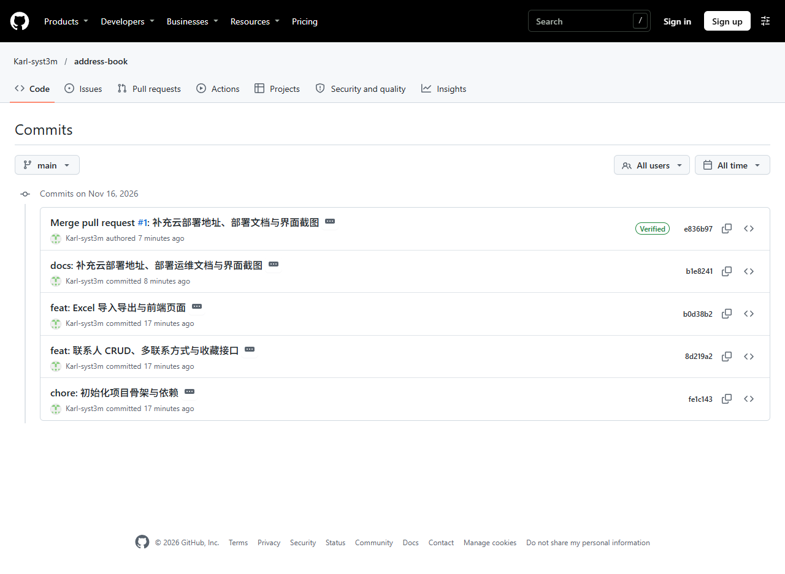

# Extreme Programming: contact book web app

Assignment page: <https://bbs.csdn.net/topics/620593436>. Deadline 2026-11-17 23:59.

| Item | Content |
| --- | --- |
| Course | Software Engineering (FZU–MU) |
| Team name | Solo project, Fang Jiawei (832401110) |
| What was asked | GitHub repo with at least 3 commits, bookmark contacts, multiple contact methods, Excel import and export, release a version and open a pull request, write a blog, cloud deployment optional |
| Goal | Build it end to end myself and see how far I get in a weekend |
| References | Node docs for `node:sqlite`, Express 4 docs, ExcelJS docs, my own [code style notes](CODE_STYLE.md) |

Chinese version of this post: [BLOG-zh.md](BLOG-zh.md)

## Contents

1. [What I built](#1-what-i-built)
2. [Links](#2-links)
3. [Commits](#3-commits)
4. [How the main parts work](#4-how-the-main-parts-work)
5. [Screenshots and video](#5-screenshots-and-video)
6. [Contribution](#6-contribution)
7. [Things that went wrong](#7-things-that-went-wrong)
8. [PSP](#8-psp)
9. [Checking myself against the rubric](#9-checking-myself-against-the-rubric)
10. [Running it](#10-running-it)

## 1. What I built

A contact book. You can bookmark people, give one person several phone numbers or emails or a WeChat account, and move everything in and out through an Excel file. It is a Node app with a browser front end, running on a small cloud server.

I did it alone, so there was no Git workflow to argue about. I still split the work into commits so the history makes some sense.

## 2. Links

- Repository: <https://github.com/Karl-syst3m/address-book>
- Running site: <http://103.236.57.2:3000>
- Release: <https://github.com/Karl-syst3m/address-book/releases/tag/v1.0.0>
- Pull requests: [#1](https://github.com/Karl-syst3m/address-book/pull/1), [#2](https://github.com/Karl-syst3m/address-book/pull/2)
- Code style notes: <https://github.com/Karl-syst3m/address-book/blob/main/docs/CODE_STYLE.md>
- Deployment notes: <https://github.com/Karl-syst3m/address-book/blob/main/docs/DEPLOY.md>

## 3. Commits



The screenshot shows the page one commit before this text was added, so the real number today is one higher.

| Contributor | Account | Commits |
| --- | --- | --- |
| Fang Jiawei (832401110) | Karl-syst3m | 12 |

The interesting part of the history, oldest first:

```
fe1c143 chore: project skeleton and dependencies
8d219a2 feat: contact CRUD, multiple methods, bookmark API
b0d38b2 feat: Excel import/export and front end
b1e8241 docs: cloud address, deployment notes, screenshots
e836b97 Merge pull request #1
10c9d17 docs: code standard document
f52071f fix: import merge treats scalar fields as authoritative
aae4ecc docs: assignment blog and demo video notes
45b2b09 Merge pull request #2
```

The two merges are there because I opened the documentation work as pull requests instead of pushing to `main` directly. I wanted the repository to show that the pull request mentioned in the assignment actually happened.

## 4. How the main parts work

### Data model

The easy mistake is putting phone and email as columns on the contacts table. That works until someone has three numbers.

So contact methods live in their own table with a foreign key to `contacts`. Each row has a type (`phone`, `email`, `wechat`, `qq`, `address`, `other`), a value, an optional label such as "work email", and a flag for the one to show first. Foreign keys are switched on and deletes cascade, so removing a person does not leave their numbers behind.

It costs an extra query when listing contacts. At this size it does not matter.

### Bookmarks

`bookmarked` is one integer column with its own endpoint, `PATCH /api/contacts/:id/bookmark`. Without it, a single star click would mean posting the whole contact and all its methods back just to flip a boolean.

The list takes `?bookmarked=1` to show only bookmarks. The star updates immediately and the counter in the header follows.

### Export

Fixed 14 columns: name, company, bookmarked, three phone columns, three email columns, WeChat, QQ, address, other, note. That is the shape the assignment asks for, one person per row and one kind of information per column.

The awkward case is a person with five phone numbers and three columns. The extras go into the "other" column as `phone:025-88889999`. Not pretty, but losing data in an export is worse.

Chinese file names needed RFC 5987 encoding, otherwise some browsers save the file as garbage.

### Import

This is the part I rewrote twice.

Version one inserted every row. Import the same file twice and you have two copies of everybody.

Version two matched on "name plus first phone or email" and merged, but only filled empty fields. So if I changed a company in Excel and imported again, nothing happened. The screen said "updated 1" and the company stayed old. That looked like the import was broken, and honestly it was.

Version three treats company and note as coming from the file: if the cell has something it overwrites, if the cell is empty the old value stays. An empty bookmark column no longer clears existing bookmarks, which version two did.

Rows are handled one at a time and errors are collected instead of aborting the file, so one bad row does not kill the import. The response is `{created, updated, skipped, errors}` and the UI shows the three numbers. Re-importing an export gives `created 0, skipped 8`, so nobody is duplicated.

### Themes

The page ships with three colour schemes and a small switcher in the header: the default blue, a warm paper look, and a dark one. The choice is kept in `localStorage` and applied by an inline script before first paint, so a reload does not flash the default colours first.

It is all CSS variables: one block redefines the palette, the components never knew a theme existed. The two headaches were the translucent header (a white 82% overlay that turned into light text on a light band in dark mode) and a pile of hard-coded light tints that had to become variables first. I only caught the header problem because I looked at the dark screenshot.


### Deployment

The app runs under systemd, starts on boot, restarts itself if it dies.

I did not touch ports 80 or 443. That server already runs nginx for other things and I did not want to break it. The app listens on 3000 and I opened that port with a ufw rule. Before the real deployment I started a throwaway listener on 3000 and hit it from outside, because a cloud firewall can block a port without telling you.

Rollback is one command, written down in [DEPLOY.md](DEPLOY.md).

## 5. Screenshots and video


Video, 1 minute 33 seconds: <https://pan.baidu.com/s/1JTFBgb6bjEEuK-pSPf4k7w?pwd=r9yt>, extraction code `r9yt`.

It goes through the list, bookmarking, adding a contact with three methods, exporting, then importing a file that reports created 1, updated 2, skipped 6.

## 6. Contribution

One person. Me. 100%.

So there is no division of labour table and no contribution split to argue about. Schema, API, Excel, front end, testing, deployment and this post are all mine.

## 7. Things that went wrong

**SQLite on Windows.** I started with `better-sqlite3` and gave up after the second `npm install` sat in node-gyp. Node 24 ships `node:sqlite`, so I used that instead and the install dropped to about six seconds with nothing to compile.

**Excel columns.** Excel wants a fixed grid, a contact has however many phone numbers it has. My first attempt made a column per phone, which falls apart when the count varies per row. Three fixed columns plus an overflow column was the compromise.

**Import doing nothing.** Covered above. I only noticed because I edited a company, imported, and the old name was still on the screen.

**Garbled file name.** Straight `filename="通讯录.xlsx"` came out mangled, so the response now sends a plain name and the RFC 5987 version.

**A button covering the cards.** The floating add button sat on top of the edit and delete links of the last row. More bottom padding on the page fixed it. Small thing, but it was the first thing I saw in my own screenshot.

**Not knowing whether the port was open.** The throwaway listener saved me from deploying and then wondering why nothing loaded.

## 8. PSP

Rough numbers from timestamps and how long things felt, not stopwatch data.

| Phase | Task | Estimated | Actual | Note |
| --- | --- | --- | --- | --- |
| Requirements | Read the page, list the graded parts | 30 | 40 | The English and Chinese versions did not say quite the same thing |
| Design | Schema, endpoints, Excel columns | 40 | 50 | Went back and forth on the column layout |
| Coding | Database layer | 60 | 50 | `node:sqlite` was easier than expected |
| Coding | API | 120 | 150 | More validation than I planned for |
| Coding | Excel import and export | 120 | 140 | Import rewritten three times |
| Coding | Front end | 170 | 210 | The dialog with dynamic rows took longest |
| Testing | Checking endpoints and edge cases | 60 | 90 | Round-trip import and cascade delete came late |
| Deployment | Server, systemd, ufw, outside check | 40 | 35 | Went fine first try |
| Docs | README, code standard, deployment notes, this post | 90 | 120 | Longer than expected |
| Fixes | Floating button and the import merge | 30 | 25 | |
| | **Total** | **770** | **910** | |

## 9. Checking myself against the rubric

| Rubric | Points | What backs it up |
| --- | --- | --- |
| Markdown post, repo link, code standard link | 10 | This file; links in section 2 |
| Notes, screenshots, division of work | 20 | Section 4, screenshots above, section 6 |
| Page style | 10 | Card layout, icons per method type, responsive, empty state, three colour themes |
| Bookmarks | 25 | Star toggle, filter, counters |
| Multiple methods | 10 | Six types, labels, primary flag, rows can be added or removed |
| Import and export | 25 | 14-column export, dedupe on import with created/updated/skipped |
| Cloud deployment (optional) | +15 | The address in section 2, reachable from outside |

## 10. Running it

```bash
git clone https://github.com/Karl-syst3m/address-book.git
cd address-book
npm ci
npm run seed
npm start
```

`npm ci` pulls 254 packages and compiles nothing. There is no database in the repo, the tables are created on first start. `npm run seed` adds eight fake contacts so the page is not empty, and it can be run again whenever the data gets messy.
